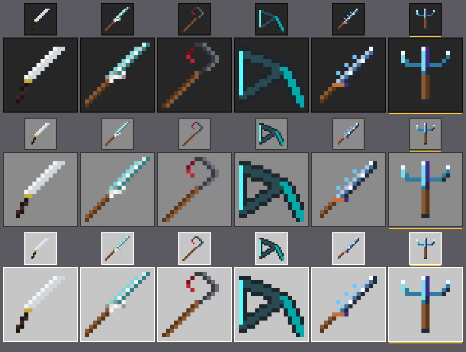
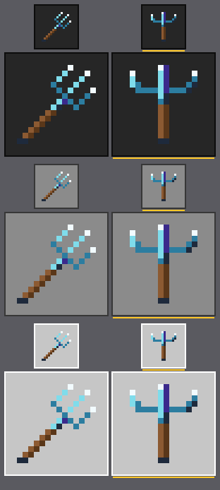
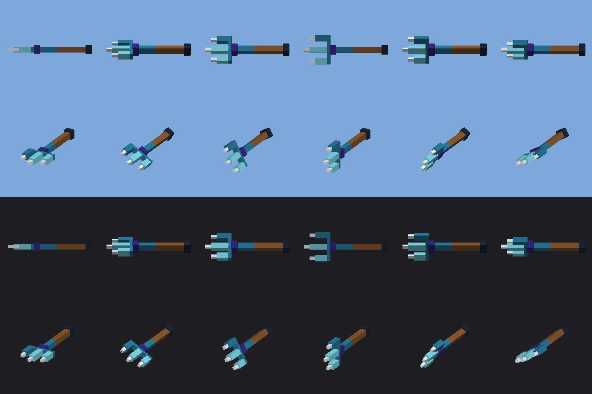

# Вид трезубца — TRDT-LOOK-01-AA

Значок `andrew_above_water_trident` и модель брошенного трезубца `andrew:trident_in_flight`. Всё нарисовано
скриптом `tools/draw-trident.mjs`: значок, текстура модели и её геометрия. Тест `tests/trident-look.test.mjs`
падает, если файл в паке разошёлся с тем, что рисует скрипт.

## Образец: принятые значки, разобранные в пиксели

Числа печатает тот же тест (`node --test tests/trident-look.test.mjs`, строки `ℹ`). L — яркость по Rec.709, от 0 до 255.

| значок | точек | цветов | самый тёмный | самый светлый | рамка |
|---|---|---|---|---|---|
| Катана | 33 | 5 | `#1E140F` L22 | `#F0F5FA` L244 | x2–13 y1–14 |
| Паутинный меч | 42 | 9 | `#5A3719` L60 | `#F5F5F5` L245 | x0–15 y0–15 |
| Коса | 37 | 6 | `#780F19` L38 | `#696E76` L110 | x0–13 y0–15 |
| Скалковый арбалет | 125 | 4 | `#1A262C` L36 | `#55FFFF` L219 | x0–15 y1–15 |
| Клинок бури | 40 | 9 | `#1E2A3C` L41 | `#FFFFFF` L255 | x1–14 y1–14 |
| **Трезубец** | **44** | **7** | **`#1E2A3C` L41** | **`#F2FBFF` L249** | **x2–13 y1–14** |

Что общее, а что нет:
- **Диагональ.** У всех пяти рукоять снизу слева, остриё сверху справа.
- **Рукоять.** Пара `#8C5A32` / `#5A3719` есть у паутинного меча, Косы и Клинка бури. Рукоять — две полосы по
  2 точки: светлая полоса сверху-слева, тёмная снизу-справа.
- **Контур.** Это не обводка по кругу, а тёмная сторона клинка, снизу справа, шириной в одну точку. Светлая кромка
  идёт с противоположной стороны.
- **Где карточка не сходится с файлами.**
  - Почти чёрный и почти белый одновременно есть только у Катаны и Клинка бури.
  - У Косы почти белого нет вовсе: самый светлый её цвет `#696E76`.
  - У паутинного меча нет почти чёрного: самое тёмное в нём — рукоять `#5A3719`.
  - В диапазон 35–46 точек не попадают Катана (33) и арбалет (125).
  - Поэтому образцом для трезубца взят Клинок бури — последний принятый значок, который выполняет все правила сразу.

## Значок



`trident-look-preview.png`: принятые значки и новый (последний, с жёлтой чертой). Три фона по строкам: тёмная
полоса, серый слот и светлая панель инвентаря. На каждом фоне два масштаба: ×3 (примерно как полоса на iPad) и ×8.

| ключ | цвет | откуда |
|---|---|---|
| `k` | `#1E2A3C` | контур Клинка бури |
| `v` | `#3A2A8C` | фиолетовый Клинка бури. Буря сказана цветом, а не формой зубцов |
| `g` / `G` | `#8C5A32` / `#5A3719` | рукоять паутинного меча, Косы и Клинка бури |
| `w` / `l` / `m` | `#F2FBFF` / `#7FDCEB` / `#2C7DA0` | вода: белые острия, светлая и тёмная морская синева |

- **Итог.** 44 непрозрачные точки, 7 цветов, поля по одной точке со всех сторон. Освещение слева: левый зубец
  светлый, правый тёмный. Под перекрестьем и у древка идёт тёмный край.
- **Что видно на превью.**
  - На тёмной полосе читается всё.
  - На светлой панели слабее всего левый зубец и белые острия. Значок держат правый зубец, фиолетовое древко,
    перекрестье и рукоять. Это та же слабость, что у принятой Катаны, у которой белый клинок на светлой панели тоже
    бледнеет.
  - В размере полосы (×3) это трезубец: три зубца, перекрестье и древко.

### Отступление от диагонали

Трезубец стоит вертикально — единственный из легендарок. Причина записана в коде над сеткой
(`tools/draw-trident.mjs`, константа `ICON`), а проверка «стоит прямо» входит в тест: рукоять — два столбца,
у трёх остриёв три отдельных столбца, между зубцами пусто.



- **Чем подкреплена причина.** `trident-look-diagonal.png`: слева набросок того же трезубца по диагонали, справа
  вертикальный.
  - На 16 точках диагональные зубцы и перекрестье состоят из одиночных точек, которые касаются друг друга только
    углами. В размере полосы голова рассыпается в крапинку.
  - Вертикальный зубец — сплошной столбец.
  - Набросок — честная попытка, а не нарочно плохой вариант. В репозиторий он не входит.
- **Не проверено.** Карточка утверждает, что ванильный трезубец нарисован стоймя. Проверить это значило бы открыть
  текстуру Mojang, а этого в задаче делать нельзя. По памяти ванильный значок в инвентаре скорее диагональный.
  Поэтому в коде причиной записано «так читаются зубцы», а не «так у ванили». Если Андрею вертикальный покажется
  чужим рядом с остальными, диагональный вариант уже нарисован.

## Модель в полёте



`trident-look-model.png`, отрисовка геометрии с текстурой (`tools/model-preview.mjs`).
- **Строки.** Вид сбоку и вид сзади-сверху, на небе и на тёмном фоне.
- **Столбцы.** Поворот вокруг древка через каждые 30°. Сбоку зубцы то сходятся в линию, то раскрываются вилкой —
  так и видно вращение.

| файл | что в нём |
|---|---|
| `packs/resource/entity/trident_in_flight.entity.json` | привязка `andrew:trident_in_flight`: материал `entity_alphatest`, текстура, геометрия, анимация `fly`, render controller |
| `packs/resource/models/entity/trident_in_flight.geo.json` | `geometry.andrew.trident_in_flight`: кость `body`, в ней кость `spin` с 11 кубами. Длина 29 px (≈1,8 блока), голова шириной 10 px |
| `packs/resource/render_controllers/trident_in_flight.render_controllers.json` | `controller.render.andrew.trident_in_flight` |
| `packs/resource/animations/trident_in_flight.animation.json` | `body` поворачивается по направлению полёта; `spin` крутится вокруг древка: `q.life_time * 720`, 2 оборота в секунду |
| `packs/resource/textures/entity/andrew_trident_in_flight.png` | 32×32, по одной плашке 8×8 на цвет из палитры значка. Грани берут только середину плашки 4×4, чтобы мип-карты на расстоянии не подмешивали соседний цвет |
| `packs/behavior/entities/trident_in_flight.json` | серверная половина, о ней ниже |

- **Как модель повёрнута.** Зубцы смотрят в −Z. Поворот `body` записан выражением ванильной стрелы:
  `["-q.target_x_rotation", "-q.target_y_rotation", 0]`. Стрела держит наконечник в −Z и этим выражением летит
  наконечником вперёд.
  - Откуда это известно: изолированный агент прочитал `arrow.entity.json`, `arrow.animation.json` и `arrow.geo.json`
    в `Mojang/bedrock-samples`. Ничего не сохранено и не скопировано.
  - У ванильного брошенного трезубца в данных нет ни анимации, ни поворота: его разворачивает движок, и повторить
    это нечем.
  - Точка сущности стоит сразу за остриями, как у стрелы, поэтому при попадании голова не уходит в стену.
- **Чего BDS не покажет.**
  - Будет ли трезубец на экране лететь остриём вперёд. Для этого нужно, чтобы `q.target_*_rotation` у сущности с
    рантаймом снежка возвращал её собственный поворот, как у стрелы.
  - Видно ли вращение.

  Оба пункта — для листа приёмки на iPad (TRDT-IPAD-01-AA). Для этого полёт не нужен: `/summon
  andrew:trident_in_flight ~ ~2 ~` ставит висящий в воздухе крутящийся трезубец.
- **Договор с задачей броска.** Модель смотрит туда, куда повёрнута сущность.
  - Пока сущность летит снарядом, поворот по движению выставляет `minecraft:projectile`.
  - На управляемом возврате поворот задаёт скрипт (`teleport` с `rotation` или `setRotation`): острия — к бросившему.

### Серверная половина — заготовка

`scripts/validate.mjs` не пропускает клиентскую сущность без сущности в BP, поэтому в BP положена инертная
заготовка `andrew:trident_in_flight`.
- Тело повторяет тарелку НЛО, которая уже грузится на BDS 1.26.51.1: рантайм снежка, без гравитации и коллизий,
  неуязвима, не толкается.
- Полёт, попадание и возврат в неё вкладывает TRDT-THROW-01-AA.
- В KV (`L0-trdt`) записаны две сущности: `andrew:thrown_above_water_trident` и `andrew:returning_above_water_trident`.
  Карточка задачи называет одну, `andrew:trident_in_flight`. Сделано по карточке. Если бросок разведёт полёт и
  возврат на две сущности, вторая получит свой файл в `entity/` и переиспользует ту же геометрию, текстуру,
  контроллер и анимацию.

## Проверки

- `npm run build`, `npm run validate`, `node --test tests/trident-look.test.mjs` — зелёные, артефакты run-check в
  `.ai/verify/TRDT-LOOK-01-AA/`. Весь `npm test`: 1318 из 1318.
- **Отрицательный контроль теста.** На место значка трезубца подложен значок Катаны — тест краснеет тремя
  проверками: «расходится с рисовальщиком», «33 точки, а образец держит 35–46» и «не стоит прямо». Затем значок
  перерисован, тест снова зелёный.
- **BDS 1.26.51.1, приватный инстанс `dist/bds-trdtlook`** (`andrew-bds-trdtlook`, порт 19986; `andrew-bds-ci`
  занят соседней задачей). `bds-check --no-build` — PASS: три запуска на одном мире, self-check `passed=18
  failed=0`, жалоб движка на пакеты нет. Затем в консоль того же сервера, в загруженном чанке:

  | команда | ответ сервера |
  |---|---|
  | `summon andrew:trident_in_flight 0 120 0` | `Object successfully summoned` |
  | `summon andrew:ufo_saucer 2 120 0` (контроль, известная сущность) | `Object successfully summoned` |
  | `summon andrew:no_such_entity 0 120 0` (контроль, неизвестный id) | `Syntax error: Unexpected "andrew:no_such_entity"` |
  | `testfor @e[type=andrew:trident_in_flight]` | `Found entity.andrew:trident_in_flight.name` |

  Сущность после проверки убита, тикающая область снята, инстанс остановлен.
- **Чего нет.** У сущности нет имени в `.lang` (`entity.andrew:trident_in_flight.name`). Пока его некуда выводить;
  понадобится, если урон броска будет засчитан от сущности (сообщение о смерти). Строки трезубца ведёт
  TRDT-ITEM-01-AA, и написание имени («Надводный трезубец» / «Above-Water Trident» или без дефиса) — её решение.

## Текстуры Mojang

- Не скачивались и не копировались. Все PNG этой задачи нарисованы скриптом из таблиц в
  `tools/draw-trident.mjs`.
- Из ванили взяты только два знания:
  - выражение поворота стрелы;
  - сторона, в которую смотрит её наконечник.

  Файлы для этого читал изолированный агент, текстур он не открывал.

## Как пересобрать

```
node tools/draw-trident.mjs
I=packs/resource/textures/items
node tools/icon-preview.mjs --out docs/feedback/trident-look-preview.png $I/andrew_dragon_katana.png \
  $I/andrew_web_sword.png $I/andrew_scythe_of_calamity.png $I/andrew_sculk_crossbow.png \
  $I/andrew_storm_blade.png $I/andrew_above_water_trident.png
node tools/model-preview.mjs --out docs/feedback/trident-look-model.png \
  --geo packs/resource/models/entity/trident_in_flight.geo.json \
  --texture packs/resource/textures/entity/andrew_trident_in_flight.png --bone spin --axis z
```
