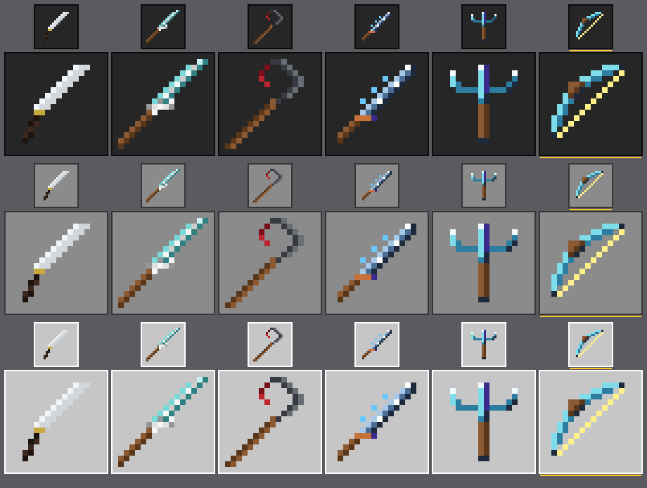
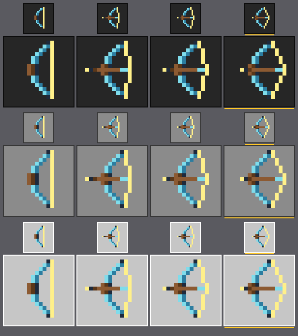
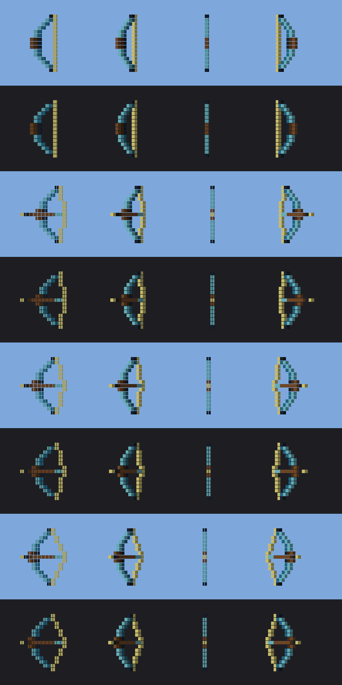

# Вид подводного лука — UBOW-LOOK-01-AA

Значок `andrew_underwater_bow` и лук в руке с тремя кадрами натяжения. Всё нарисовано скриптом
`tools/draw-underwater-bow.mjs`: значок, четыре текстуры для руки и геометрия из них. Тест
`tests/underwater-bow-look.test.mjs` падает, если файл в паке разошёлся с тем, что рисует скрипт.

```
node tools/draw-underwater-bow.mjs                          # перерисовать файлы пака
node tools/draw-underwater-bow.mjs --preview docs/feedback  # и превью
```

## Значок



`underwater-bow-look-preview.png`: пять принятых легендарок и лук (последний, с жёлтой чертой). Три фона по строкам:
тёмная полоса, серый слот, светлая панель; на каждом ×3 (размер полосы) и ×8.

| ключ | цвет | откуда |
|---|---|---|
| `l` / `m` | `#7FDCEB` / `#2C7DA0` | светлая и тёмная морская синева трезубца: вода |
| `w` | `#FFF08A` | тетива цвета молнии. Она же почти белый цвет (L 236), который держит значок на тёмной полосе |
| `k` | `#1E2A3C` | контур Клинка бури: концы плеч и тень под рукоятью |
| `g` / `G` | `#8C5A32` / `#5A3719` | рукоять паутинного меча, Косы и Клинка бури |

Числа печатает тест (`node --test tests/underwater-bow-look.test.mjs`, строки `ℹ`). L — яркость по Rec.709.

| значок | точек | цветов | самый тёмный | самый светлый | рамка |
|---|---|---|---|---|---|
| Катана | 33 | 5 | `#1E140F` L22 | `#F0F5FA` L244 | x2–13 y1–14 |
| Паутинный меч | 42 | 9 | `#5A3719` L60 | `#F5F5F5` L245 | x0–15 y0–15 |
| Коса | 37 | 6 | `#780F19` L38 | `#696E76` L110 | x0–13 y0–15 |
| Клинок бури | 40 | 9 | `#1E2A3C` L41 | `#FFFFFF` L255 | x1–14 y1–14 |
| Трезубец | 44 | 7 | `#1E2A3C` L41 | `#F2FBFF` L249 | x2–13 y1–14 |
| **Подводный лук** | **46** | **6** | **`#1E2A3C` L41** | **`#FFF08A` L236** | **x1–13 y1–13** |

- **Форма.** Ванильная диагональ: тетива — прямая из левого нижнего угла в правый верхний, плечи выгнуты вверх-влево,
  рукоять посередине дуги. Лук симметричен относительно диагонали x = y (тест проверяет каждую точку).
- **Рукоять.** Две полосы по три точки: светлая `#8C5A32` снаружи дуги (вверх-влево), тёмная `#5A3719` внутри. Под
  ними две точки `#1E2A3C` — тёмная сторона, как у клинков.
- **Стихия сказана цветом, не формой.** Вода — плечи в синеве трезубца, молния — жёлтая тетива. Искр и молний-силуэтов
  на значке нет.
- **Что видно на превью.** На тёмной полосе читается всё. На светлой панели слабее всего наружная светлая синева и
  тетива; лук держат тёмная внутренняя дуга, рукоять и концы плеч. Та же слабость у принятых Катаны и трезубца.
- **46 точек — верхняя граница образца.** Добавить точку значку уже нельзя: тест покраснеет.

## Значок за состоянием предмета не следует

**Значок в инвентаре и в хотбаре не меняется, пока лук натягивают. Анимируется только лук в руке.** Это не выбор, а
предел движка для кастомного предмета, измеренный на арбалете (`docs/feedback/probe-crossbow-look.md`):
- в `minecraft:icon` нет ключей по состоянию: `pulling`/`charged` движок молча принимает и не читает (Q1);
- attachable значок не трогает (Q2);
- `flipbook_textures.json` документирован только для блоков и от состояния не зависит (Q5);
- `dyeable` даёт одну вторую картинку и её оттенок, а не кадры (Q4).

В `item_texture.json` у ключа `andrew_underwater_bow` одна текстура, не список. Тест это держит.

## В руке: три кадра натяжения



`underwater-bow-look-frames.png`: четыре текстуры руки — покой и три кадра натяжения.



`underwater-bow-look-hand.png`: геометрия с каждой из четырёх текстур (`tools/model-preview.mjs`), сверху вниз — покой,
кадры 1–3. Столбцы — поворот лука вокруг его длинной оси через 45°; на 90° лук виден ребром, толщиной в одну точку.

| файл | что в нём |
|---|---|
| `attachables/underwater_bow.json` | привязка к `andrew:underwater_bow`: материал `entity_alphatest`, четыре текстуры, геометрия, анимация первого лица, Molang кадра |
| `textures/entity/andrew_underwater_bow_{standby,pulling_0,pulling_1,pulling_2}.png` | кадры 16×16 в палитре значка. Лук в них стоит прямо: в третьем лице поворачивать нечего |
| `models/entity/underwater_bow.geo.json` | `geometry.andrew.underwater_bow`: кости `root` → `bow` → `sprite`, 74 куба — по одному на каждую точку, непрозрачную хоть в одном кадре |
| `render_controllers/underwater_bow.render_controllers.json` | `Array.pull_frames[v.frame]` — текстура по номеру кадра |
| `animations/underwater_bow.animation.json` | первое лицо: `bow` 90° вокруг x, `sprite` 90° вокруг длинной оси лука |

- **Как меняется кадр.** Геометрия одна на все кадры. Каждый куб берёт свою точку из той текстуры, что сейчас
  показана; где в этом кадре прозрачно, `entity_alphatest` куб не рисует. Так кадр меняется заменой текстуры, как у
  ванильного лука.
- **Что двигается.** Плечи и рукоять одинаковы во всех кадрах, кроме средней строки, где стрела ложится поверх
  рукояти. Тетива с каждым кадром оттянута на точку дальше (V к держащему), стрела лежит на тетиве и отходит назад
  вместе с ней: наконечник у кадра 3 стоит прямо перед рукоятью.
- **Номер кадра** — из двух запросов, которые проба арбалета замерила живыми на кастомном предмете (Q3):

  ```
  v.drawn = (q.main_hand_item_use_duration > 0) ? (q.main_hand_item_max_duration - q.main_hand_item_use_duration) : -1;
  v.frame = (v.drawn < 0) ? 0 : ((v.drawn < 10) ? 1 : ((v.drawn < 20) ? 2 : 3));
  ```

  `main_hand_item_use_duration` — оставшиеся тики сессии использования, 0 в покое; `main_hand_item_max_duration` —
  длина сессии. Разность — сколько тиков тянут, при любой длине сессии (тест гоняет 20, 50 и 72000 тиков).
  - покой → 0 (`standby`);
  - с первого тика натяжения → 1;
  - с 10-го тика (половина натяжения) → 2;
  - с 20-го тика → 3 и держится, пока не отпустят. 20 тиков = `max_draw_duration` ванильного лука 1,0 с
    (`L0-uwbw-eitm`), то есть последний кадр — это полная сила выстрела.

  Свой таймер у анимации отсутствует: нет ключевых кадров, длины и `anim_time`. Каждое сравнение в своих скобках
  (клиент связывает `&&` сильнее `==`).
- **Почему не как у ванильного лука.** Изолированный агент прочитал в `Mojang/bedrock-samples` (`main`, 46ba6ea9)
  `attachables/bow.json`, `models/entity/bow.geo.json`, `animations/bow.animation.json`,
  `render_controllers/bow.render_controllers.json` и анимации игрока. Ничего не скопировано.
  - Ванильный лук строит модель из текстуры полем `texture_meshes`, а схема помечает его как EXPERIMENTAL. Проекту
    экспериментальное нельзя (C-2), поэтому кубы.
  - Ванильный кадр — `query.get_animation_frame`, его ставит движок. У кастомного предмета он 0 всё натяжение (Q3),
    поэтому кадр считается из двух запросов выше.
  - Пороги кадров ванильного лука в данных не записаны (их держит движок). Здесь правило своё: половина натяжения и
    полная сила.

### Положение в руке — выведено, не измерено

На Mac нет клиента, BDS ничего не рисует. Сделано на тех же допущениях, что и арбалет (`src/sculk/README.md`), чтобы
одна проверка на iPad подтвердила или поправила оба:
- `root` привязан к слоту руки (`q.item_slot_to_bone_name(c.item_slot)`); движок снимает 24 точки по y у привязанной
  кости, поэтому точка рукояти стоит в y 24, z 0;
- третье лицо: без поворота. Лук стоит вертикально, дуга смотрит вперёд (−z, куда смотрит кисть), тетива — к держащему;
- первое лицо: `bow` поворачивается на 90° вокруг x, тем же углом, что арбалет. Плоский лук после этого виден бы
  ребром, поэтому `sprite` дополнительно поворачивается на 90° вокруг своей длинной оси — к камере лицом.

Если на iPad лук окажется зеркальным или боком, правятся два угла в `animations/underwater_bow.animation.json`.

## Отклонения (C-16)

1. **Значок не анимируется** — раздел выше.
2. **В третьем лице руки не поднимаются в позу лучника.** Ванильная поза включается условием
   `query.get_equipped_item_name == 'bow' && (...)` в `player.animation_controllers.json`, наш id под него не
   подходит. Поменять это можно только переопределив `player.entity.json` Mojang, который ломается с обновлениями.
   Не делалось.
3. **Нет дрожания и подтягивания к камере при полном натяжении** в первом лице (у ванили это
   `wield_first_person_pull`). Натяжение видно только по кадрам.
4. **В левой руке лук следует за правой.** Запросы — правой руки. Ванильный лук не берётся в левую руку вовсе;
   разрешит ли её наш, решает UBOW-ITEM-01 по замеру UBOW-PROBE-01.
5. **Свечения чар на луке в руке нет** — attachable его не рисует. Добавит ли движок своё — проверка на iPad (то же у
   арбалета, отклонение 7).

## Пока предмета нет

Предмет `andrew:underwater_bow` делает UBOW-ITEM-01. Здесь его нет, и это нарочно:
- заглушка предмета в BP сломала бы проверку стола зачарований: `NOT_SHIPPED` в `src/enchanting/eligibility.ts` и
  `tests/enchanting-eligibility.test.mjs` требуют, чтобы появившийся лук перемерили (`andrew:ench_data_parity`);
- `scripts/validate.mjs` не пропускает attachable без предмета. Для этого есть `ATTACHABLE_BEFORE_ITEM`: id из
  списка проходит без предмета, а когда предмет появится, сам список становится ошибкой
  (`andrew:underwater_bow ships now: drop it from ATTACHABLE_BEFORE_ITEM`). Остальные attachable проверяются как раньше.

Договор с UBOW-ITEM-01, который тест проверит сам, как только файл предмета появится:
- `minecraft:icon` = `andrew_underwater_bow`;
- `max_draw_duration` = 1,0 с (последний кадр — полная сила);
- `use_duration` не короче натяжения, иначе последний кадр не наступит.

## Проверки

- `node tools/draw-underwater-bow.mjs` перерисовывает ровно закоммиченные файлы (`git diff --exit-code` пуст).
- `tests/underwater-bow-look.test.mjs`: числа значка против образца, рукоять, диагональ и симметрия, кадры, геометрия,
  связка attachable → геометрия → контроллер → текстуры, запросы, скобки, кадр по тикам натяжения.
- `tests/validate.test.mjs`: `ATTACHABLE_BEFORE_ITEM` пропускает только свой id и становится ошибкой, когда предмет есть.
- `npm run build` с валидацией; BDS 1.26.51.1 (`bds-check` на частном инстансе): пак ресурсов принят, на пакеты движок
  не жалуется. Attachable сервер не загружает вовсе (Q2) — вид в руке закрывает только iPad.

## На iPad (UBOW-IPAD-01)

С луком из UBOW-ITEM-01, Выживание, стрелы в инвентаре, первое и третье лицо:
1. В хотбаре и инвентаре — синий лук с жёлтой тетивой и коричневой рукоятью, читается на тёмной полосе и светлой панели.
2. В руке — объёмный лук, а не плоский значок; стоит вертикально, дуга вперёд.
3. Пока держат нажатие, тетива оттягивается в три шага и появляется стрела; на третьем шаге (через 1 с) лук натянут
   полностью и так стоит до выстрела.
4. Отпустили — тетива прямая, стрелы нет.
5. Значок в хотбаре всё это время не меняется.
6. Первое лицо: лук виден лицом, не ребром; не зеркален.
7. Зачарованный лук в руке: есть ли свечение.

## Текстуры Mojang

Не скачивались и не копировались. Все PNG этой задачи нарисованы скриптом из таблиц в `tools/draw-underwater-bow.mjs`.
